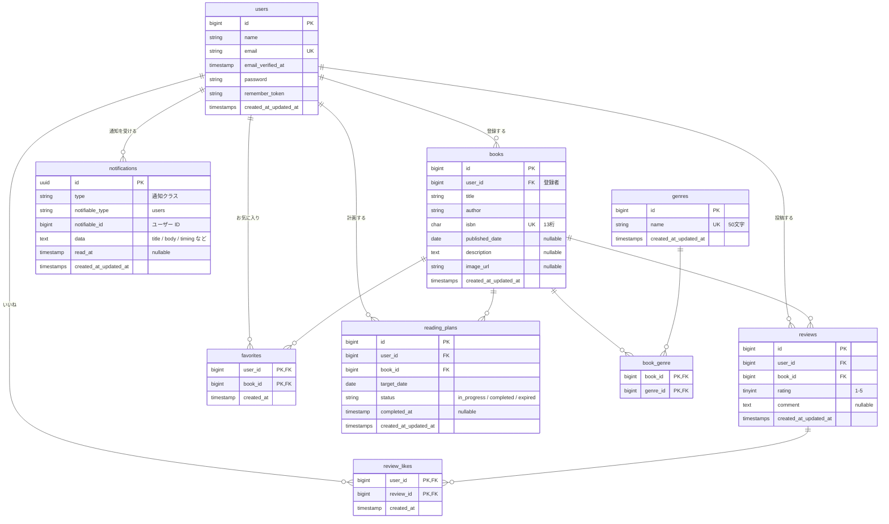

# BookShelf 書籍レビューアプリ

## 概要

ユーザーが書籍を登録・閲覧し、レビューの投稿、お気に入り登録、レビューへのいいねを行える書籍レビューアプリです。書籍はジャンルで分類され、レビューの平均評価によるランキングを確認できます。画面（Blade + セッション認証）に加えて、外部アプリケーション向けの公開 API（JSON）も提供します。
また、書籍一覧の検索・並び替え、ISBN からの書籍情報の自動入力（Google Books API）、マイ読書レポート、読書計画とリマインダー通知（日次バッチ）、公開 API の Sanctum トークン認証を備えています。

## 使用技術

- PHP 8.5（Sail ランタイム。`composer.json` の要求は ^8.1）
- Laravel 10.x
- MySQL 8.4
- Laravel Sail（Docker）
- Laravel Fortify（認証）
- Laravel Sanctum（公開 API のトークン認証）
- Google Books API（ISBN 検索。`Http` ファサードで呼び出し）
- Blade / Vite 5 / Tailwind CSS 3 / Alpine.js 3
- PHPUnit（テストは SQLite インメモリ）/ Laravel Pint

## 環境構築手順

1. リポジトリを取得する

```bash
git clone git@github.com:Yoshi14-M/bookshelf-app.git
cd bookshelf-app
```

2. `.env.example` を `.env` にコピーする

```bash
cp .env.example .env
```

3. 依存パッケージをインストールする（clone 直後は `vendor/` が無く sail を実行できないため、Docker で composer を実行する）

```bash
docker run --rm \
  -u "$(id -u):$(id -g)" \
  -v "$(pwd):/var/www/html" -w /var/www/html \
  -e COMPOSER_CACHE_DIR=/tmp/composer_cache \
  laravelsail/php82-composer:latest \
  composer install --ignore-platform-reqs
```

4. Sail を起動し、アプリケーションキーを生成する

```bash
./vendor/bin/sail up -d
./vendor/bin/sail artisan key:generate
```

5. マイグレーション・シーディングを実行する

```bash
./vendor/bin/sail artisan migrate --seed
```

6. フロントエンドをビルドする（開発中は `npm run dev` を起動したままにする）

```bash
./vendor/bin/sail npm install
./vendor/bin/sail npm run dev
```

7. アクセスする
    - アプリ: http://localhost
    - phpMyAdmin: http://localhost:8080
    - Vite 開発サーバー: http://localhost:5173

ポートは `.env` の `APP_PORT` / `FORWARD_PHPMYADMIN_PORT` / `VITE_PORT` で変更できます。

### ISBN 検索（Google Books API）の設定

書籍の登録・編集画面の「ISBN から書籍情報を自動入力」は Google Books API を呼び出します。キーなしの匿名アクセスは利用上限（日次クォータ）が 0 で 429 になるため、[Google Cloud](https://console.cloud.google.com/) で「Books API」を有効にして API キーを発行し、`.env` に設定してください（未設定・失敗時は画面にエラーを表示します）。

```
GOOGLE_BOOKS_API_KEY=発行したキー
GOOGLE_BOOKS_API_URL=https://www.googleapis.com/books/v1/volumes   # 省略可
```

`GET /books/isbn/{isbn}` のレスポンス（認証不要。失敗時は `{"error": "…"}`）:

| 状況                            | ステータス | `error` のメッセージ                                                                         |
| ------------------------------- | ---------- | -------------------------------------------------------------------------------------------- |
| 取得成功                        | 200        | （`title` / `author` / `description` / `image_url` / `published_date` を返す）               |
| ISBN が 13 桁の数字でない       | 400        | ISBNは13桁で入力してください。                                                               |
| 書籍が見つからない              | 404        | 書籍が見つかりませんでした。                                                                 |
| Google Books API のクォータ超過 | 429        | Google Books API のクォータを超過しました。.env に GOOGLE_BOOKS_API_KEY を設定してください。 |
| その他の API 通信エラー         | 500        | API通信エラーが発生しました。                                                                |

### 読書計画の日次バッチ（通知・自動失効）の設定

読書計画の期限切れへの更新とリマインダー通知は、Laravel のスケジューラ（Schedule + Console Command）で毎日実行されます。既定の実行時刻は **20:00**（アプリのタイムゾーン `Asia/Tokyo`）で、`.env` の `READING_PLAN_BATCH_TIME`（`HH:MM` 形式）で変更できます。

```
READING_PLAN_BATCH_TIME=20:00   # 省略可。例: 06:30
```

| コマンド               | 内容                                                                                                                  |
| ---------------------- | --------------------------------------------------------------------------------------------------------------------- |
| `reading-plans:expire` | 期日を経過した進行中（`in_progress`）の計画を期限切れ（`expired`）にする。期日が今日の計画は対象外                    |
| `reading-plans:remind` | 期日の 3 日前・当日の進行中の計画と、3 日後の期限切れの計画の所有者に通知（データベースのみ）を送る。完了済みは対象外 |

- 用語: **失効**はバッチ処理（`reading-plans:expire`）、**期限切れ**は計画のステータス（`expired`）です。失効処理で進行中の計画が期限切れになり、リマインド処理が期限切れの計画を「期日の 3 日後」の通知の対象にします。
- スケジューラは、先に `reading-plans:expire`、次に `reading-plans:remind` の順で実行します（失効の後にリマインドするため、期日の 3 日後の通知は期限切れになった計画が対象です）。
- スケジューラの起動: 本番は cron で `* * * * * php artisan schedule:run` を登録します。開発環境（Sail）では次のどちらかで確認できます。

```bash
./vendor/bin/sail artisan schedule:work   # 起動したままにして、設定した時刻に自動実行
./vendor/bin/sail artisan schedule:list   # 登録内容と次回の実行時刻を確認

# 時刻を待たずに動作確認する（この順で実行する）
./vendor/bin/sail artisan reading-plans:expire
./vendor/bin/sail artisan reading-plans:remind
```

- シードの読書計画で確認する場合: 山田太郎（`yamada@example.com`）でログインし、上記コマンドを実行すると、通知一覧（`/notifications`）に 3 通（期日の 3 日前・当日・3 日後）が届き、期日を 3 日過ぎていた計画は「期限切れ」になります。

## ログイン情報（シーディングで自動作成）

ユーザー 5 名・ジャンル 10 件・書籍 11 冊・レビュー・お気に入り・いいね・読書計画 6 件が投入されます。パスワードは全員 `password` です。

| 名前     | メールアドレス        | パスワード |
| -------- | --------------------- | ---------- |
| 山田太郎 | yamada@example.com    | password   |
| 鈴木花子 | suzuki@example.com    | password   |
| 田中一郎 | tanaka@example.com    | password   |
| 佐藤美咲 | sato@example.com      | password   |
| 高橋健太 | takahashi@example.com | password   |

- ログイン: http://localhost/login
- 会員登録: http://localhost/register
- 書籍は山田太郎の登録として投入されます。

## 主な機能

### ゲスト（ログイン不要）

- 書籍一覧（`/`、`/books`。10 件/ページ）。キーワード（タイトル・著者の部分一致）・ジャンルの絞り込み・並び替え（新しい順 / 古い順 / 評価順 / タイトル順）を併用でき、ページ遷移でも条件を維持
- 書籍詳細（`/books/{book}`。ジャンル・レビュー・平均評価を表示）
- レビュー平均評価ランキング（`/ranking`。上位 10 件。レビューのない書籍は対象外、同点は書籍 ID 昇順）

### ログインユーザー

- 会員登録・ログイン・ログアウト
- 書籍の登録（`/books/create`）。編集・削除は登録者のみ（`/books/{book}/edit`）。登録・編集画面で ISBN（13 桁）から Google Books API を検索し、タイトル・著者・概要・画像・出版日をフォームに自動入力（`GET /books/isbn/{isbn}`、認証不要。上記の API キーが必要）
- ジャンルの一覧・詳細・登録・編集・削除（`/genres`。書籍が紐付いているジャンルは削除不可）
- レビューの投稿（書籍詳細から）。編集・削除は投稿者のみ（`/reviews/{review}/edit`）
- レビューへのいいね（トグル。`POST /reviews/{review}/like`）
- お気に入り登録（トグル。`POST /books/{book}/favorites`）とお気に入り一覧（`/favorites`）
- 通知（`/notifications`）。読書計画のリマインダー（期日の 3 日前・当日・3 日後）を新しい順に表示し、未読の件数をヘッダーのベルに表示。「既読にする」で既読化（自分の通知のみ。他人の通知は 404）
- 読書計画（`/reading-plans`）。書籍と期日（今日以降）で計画を登録し、状態（進行中 / 完了 / 期限切れ）で絞り込み。期日の昇順で自分の計画だけを表示。「読了する」で完了（完了日時を記録）、期日の変更は完了前のみ（期限切れの計画の期日を今日以降にすると進行中に戻る）、削除は状態を問わず可。同じ書籍の進行中の計画は重複して登録できない
- マイ読書レポート（`/reports`）。自分のレビューだけを集計し、総レビュー数・読了冊数（レビューした書籍の重複なし件数）・平均評価、評価分布（星 1〜5 の件数）、高評価書籍 TOP5（評価 4 以上。同じ書籍は 1 冊として数える）、ジャンル別評価傾向 TOP5（平均評価の降順 → 件数の降順）を表示

### 公開 API（`/api/v1/books`）

ベース URL は `http://localhost/api/v1` です。参照（GET）は認証不要で、書き込み系（POST / PUT / PATCH / DELETE）は Laravel Sanctum のトークン認証（`Authorization: Bearer {トークン}`）が必要です。`Accept` ヘッダの有無にかかわらず常に JSON で応答します。

| メソッド    | URI                    | 概要                                                     | 認証 | 成功時 |
| ----------- | ---------------------- | -------------------------------------------------------- | ---- | ------ |
| GET         | `/api/v1/books`        | 書籍一覧（ジャンル・平均評価・レビュー件数つき、新着順） | 不要 | 200    |
| GET         | `/api/v1/books/{book}` | 書籍詳細（ジャンルとレビューつき）                       | 不要 | 200    |
| POST        | `/api/v1/books`        | 書籍登録（登録者はトークンの所有者）                     | 必要 | 201    |
| PUT / PATCH | `/api/v1/books/{book}` | 書籍更新（登録者のみ）                                   | 必要 | 200    |
| DELETE      | `/api/v1/books/{book}` | 書籍削除（登録者のみ）                                   | 必要 | 204    |

- **一覧のクエリパラメータ**: `keyword`（タイトル・著者の部分一致）、`genre_id`、`page`、`per_page`（1〜100、既定 20）
- **登録・更新のリクエスト項目**: `title`、`author`、`isbn`（13 桁・一意）、`published_date`、`description`、`image_url`、`genres[]`（1 つ以上）
    - 登録者はリクエストの項目ではなくトークンの所有者になります（`user_id` を送っても無視され、レスポンスにも含まれません）。更新で登録者は変わりません。
- **エラー**: 存在しない書籍は 404 `{"message": "書籍が見つかりません。"}`、バリデーションエラーは 422（日本語メッセージ）、トークンが無い・不正は 401 `{"message": "Unauthenticated."}`、他人の書籍の更新・削除は 403 `{"error": "この操作を実行する権限がありません。"}`。レスポンスの `average_rating` は小数第 1 位（レビューなしは `null`）
- **トークンの用意**: トークンを発行する API は用意していません（既存のエンドポイントに `auth:sanctum` を付けた構成です）。手元で試すときは、Sail の tinker で発行します。

```bash
./vendor/bin/sail artisan tinker --execute='echo App\Models\User::where("email", "yamada@example.com")->first()->createToken("local")->plainTextToken;'
```

```bash
curl -s "http://localhost/api/v1/books?keyword=PHP&per_page=5"
curl -s -X POST http://localhost/api/v1/books \
  -H 'Authorization: Bearer {発行したトークン}' \
  -H 'Content-Type: application/json' \
  -d '{"title":"サンプル","author":"著者","isbn":"9784000000001","published_date":"2024-01-01","genres":[1]}'
```

## テストの実行

```bash
./vendor/bin/sail artisan test
```

- 各テストクラスは `RefreshDatabase` を使い、DB は SQLite インメモリ（`phpunit.xml`）です。
- テストメソッドは `/** @test */` を付け、検証内容が分かる日本語名にしています。
- 書籍検索のキーワード記号（`%` `_` `\`）の挙動を確認するテスト 1 件は、MySQL の `LIKE` 仕様に依存するため、SQLite では skip されます。
- カバレッジの確認（目標: 基本 60% 超 / 応用 80% 以上）: `SAIL_XDEBUG_MODE=coverage ./vendor/bin/sail artisan test --coverage`（現在 99.3%）
- MySQL でも全テストを実行する場合（skip されるテストも実行される）。開発 DB を初期化しないよう、Sail が作成済みの `testing` DB を指定します。

```bash
./vendor/bin/sail exec -u sail -e DB_CONNECTION=mysql -e DB_DATABASE=testing laravel.test php artisan test
```

## コード整形（Laravel Pint）

```bash
./vendor/bin/sail bin pint          # 整形
./vendor/bin/sail bin pint --test   # チェックのみ
```

## ER図



- Book ⇄ Genre は多対多（中間テーブル `book_genre`）。ジャンルは書籍が紐付いている間は削除できません（`restrictOnDelete`）。
- お気に入り（User ⇄ Book）、いいね（User ⇄ Review）は多対多の中間テーブルで、複合主キーにより重複登録を防ぎます。
- 書籍の削除は `BookService` が 1 つのトランザクションで、レビューのいいね・レビュー・お気に入り・ジャンルの紐付け・読書計画を明示的に削除してから書籍を削除します（途中で失敗すると何も削除されません）。外部キーにも `CASCADE` を設定しており、ユーザー・レビューの削除でも紐付くデータが削除されます。
- 上記以外に Laravel 標準の `notifications`（通知。ユーザーに紐付く）/ `password_reset_tokens` / `failed_jobs` / `personal_access_tokens`（Sanctum のトークン）があります。

### テーブル概要

| テーブル        | 説明                                                                              |
| --------------- | --------------------------------------------------------------------------------- |
| `users`         | ユーザー（会員登録・ログイン用）                                                  |
| `genres`        | ジャンル（共有マスタ。名前は一意）                                                |
| `books`         | 書籍。`user_id` は登録者、`isbn` は 13 桁で一意。`published_date` は任意          |
| `book_genre`    | 書籍とジャンルの中間テーブル（1 冊に複数ジャンル可）                              |
| `reviews`       | 書籍へのレビュー（評価 1〜5・コメント）。同一ユーザーが同じ書籍に複数投稿可       |
| `favorites`     | ユーザーの書籍お気に入り（中間テーブル）                                          |
| `review_likes`  | ユーザーのレビューへのいいね（中間テーブル）                                      |
| `notifications` | Laravel 標準の通知（データベースチャネル）。読書計画のリマインダーを保存          |
| `reading_plans` | 読書計画（ユーザー・書籍・期日・状態・完了日時）。状態は Enum `ReadingPlanStatus` |

## ディレクトリ構成の補足

- `app/Http/Controllers/BookController.php` / `app/Services/BookService.php` : 書籍の一覧・詳細・登録・編集・削除（登録・更新・削除は `BookService` が `DB::transaction()` で実行。Web と公開 API で共有）
- `app/Http/Controllers/BookIsbnController.php` / `app/Services/GoogleBooksService.php` : ISBN 検索（Google Books API を `Http` ファサードで呼び出し、フォーム用に整形）。URL・キーは `config/services.php`（`.env`）
- `app/Http/Controllers/GenreController.php` / `ReviewController.php` : ジャンル管理、レビューの投稿・編集・削除
- `app/Http/Controllers/FavoriteController.php` / `ReviewLikeController.php` : お気に入り一覧・トグル、いいねのトグル
- `app/Http/Controllers/RankingController.php` : 平均評価ランキング
- `app/Console/Commands/ExpireReadingPlans.php` / `SendReadingPlanReminders.php` / `app/Services/ReadingPlanReminderService.php` / `app/Notifications/ReadingPlanReminder.php` / `app/Enums/ReminderTiming.php` : 読書計画の日次バッチ（失効とリマインダー通知。スケジュールは `app/Console/Kernel.php`、実行時刻は `config/bookshelf.php`）
- `app/Http/Controllers/NotificationController.php` : 通知一覧・既読化
- `app/Http/Controllers/ReadingPlanController.php` / `app/Enums/ReadingPlanStatus.php` / `app/Policies/ReadingPlanPolicy.php` : 読書計画（CRUD・読了。状態は Enum + Eloquent cast、所有者のみ操作可、完了した計画は編集不可）
- `app/Http/Controllers/ReportController.php` / `app/Services/ReadingReportService.php` : マイ読書レポート（自分のレビューの集計。Collection で集計）
- `app/Http/Controllers/Api/V1/BookController.php` : 公開 API（`/api/v1/books`）
- `app/Http/Requests/` : バリデーション（FormRequest。日本語の `messages()` を実装）。書籍の共通ルールは `Concerns/HasBookRules.php`、API 用は `Api/V1/`
- `app/Http/Resources/` : API レスポンスの整形（`BookResource` / `GenreResource` / `ReviewResource`）
- `app/Policies/` : 認可（`BookPolicy` / `ReviewPolicy` / `ReadingPlanPolicy` は本人のみ、`GenrePolicy` はログイン済みなら可）
- `app/Models/Book.php` : `search`（タイトル・著者の部分一致）・`inGenre`（ジャンル絞り込み）・`sortBy`（並び替え）のスコープ
- `app/Enums/BookSort.php` : 一覧の並び順（`latest` / `oldest` / `title` / `rating`）
- `app/Actions/Fortify/CreateNewUser.php` : 会員登録処理 / `app/Providers/FortifyServiceProvider.php` : ログイン・登録画面の紐付け
- `config/bookshelf.php` : 1 ページの表示件数・ランキング件数・API の既定件数
- `lang/ja/`, `lang/ja.json` : 日本語のバリデーション・認証メッセージ（手動配置）

## 作成者

松井 義朗（GitHub: [Yoshi14-M](https://github.com/Yoshi14-M)）
